<p align="center">
  
</p>

<p align="center">
  
  
  
  
</p>

<p align="center">
  <b>Português (Brasil)</b>
</p>

**Seu acervo de HQs, em casa.** O ComicVault é um leitor de quadrinhos
self-hosted: você aponta para a pasta onde estão suas HQs e lê tudo no navegador,
no computador ou no celular, com efeito de virar página, modo rolagem, zoom,
histórico e vários temas. Seus arquivos ficam no seu servidor, sem conta, sem
nuvem de terceiros.

```
$ npm run dev
  Backend rodando em http://0.0.0.0:3001
  ComicVault pronto em http://localhost:5173
```

<!--
  Adicione aqui um print ou GIF da tela principal, por exemplo:
  <p align="center"></p>
-->

## Sumário

- [O que ele faz](#o-que-ele-faz)
- [Começando](#começando)
- [Usando o leitor](#usando-o-leitor)
- [Temas](#temas)
- [Como funciona](#como-funciona)
- [Configuração](#configuração)
- [Estrutura do projeto](#estrutura-do-projeto)
- [Licença](#licença)

## O que ele faz

**Leitor**

- **Efeito de virar página** com arrasto de mouse ou toque
  ([react-pageflip](https://github.com/Nodlik/react-pageflip)), em página
  simples ou **página dupla**, como um livro aberto.
- **Modo rolagem**: as páginas empilhadas na vertical, no estilo webtoon, para
  ler só rolando.
- **Zoom até 300%** por botões, teclado ou gesto de pinça, e **pan** arrastando
  a página quando há zoom.
- **Salva o progresso** e oferece "Continuar da página X" ao reabrir o arquivo.
- **Pré-carrega as páginas** ao redor da atual, então só algumas imagens ficam
  na memória, mesmo em arquivos grandes.
- Interface que some sozinha depois de 3 segundos, para ler sem distração.

**Biblioteca**

- Aponte a **pasta da biblioteca** nas configurações e recarregue: sem editar
  arquivos de configuração.
- **Lidos recentemente**: os últimos 10 arquivos, com a página em que você
  parou. HQs que foram apagadas do disco saem do histórico sozinhas.
- Barra lateral única com início, pesquisa, biblioteca, lidos recentemente e
  configurações.

**Geral**

- **8 temas** prontos, claros e escuros.
- **Feito para o celular**: o leitor trava o scroll da página, aceita gestos de
  toque e se ajusta à largura da tela.
- **Self-hosted**: roda na sua máquina, no seu NAS ou num servidor, e você acessa
  de qualquer aparelho da rede.

## Começando

Você precisa do [Node.js](https://nodejs.org) 20 ou mais novo e de uma pasta com
suas HQs. Docker é opcional.

```bash
git clone https://github.com/CauaCurisno1446/Comic-Vault
cd comicvault
```

**Backend**

```bash
cd server
npm install
npm run dev
```

**Frontend**

```bash
npm install
npm run dev           # abre em http://localhost:5173
```

**Pelo celular ou outro computador:** o frontend fala com o backend usando o
mesmo endereço da página na porta `3001`. Abra `http://IP-DO-SERVIDOR:5173` e
libere as portas `5173` e `3001` no firewall da máquina.

### Com Docker

```bash
docker compose up -d
```

Monte a pasta das suas HQs como volume no `docker-compose.yml` e use esse
caminho **de dentro do contêiner** em Configurações → Biblioteca.

## Usando o leitor

| Ação | Como |
|---|---|
| Próxima página | `→` `↓` ou o botão da direita |
| Página anterior | `←` `↑` ou o botão da esquerda |
| Aumentar / diminuir zoom | `+` / `-`, os botões da barra superior, ou pinça no celular |
| Mover a página com zoom | arrastar com o mouse ou o dedo |
| Sair do leitor | `Esc` ou o `X` da barra superior |
| Abrir configurações | o ícone de engrenagem na barra superior |

Em **Configurações** você liga e desliga:

- **Página dupla**: duas páginas lado a lado, como um livro aberto;
- **Modo rolagem**: rolagem vertical contínua, sem efeito de virar;
- **Salvar progresso**: lembra a última página lida de cada arquivo;
- **Tema**: troca a aparência na hora.

No modo rolagem, as setas e os botões laterais rolam cerca de 85% da altura da
tela, e o zoom aumenta a largura da coluna.

## Temas

| Tema | Estilo |
|---|---|
| Midnight | escuro, azul-noite |
| Ocean | escuro, tons de azul |
| Dracula | escuro, roxo e rosa |
| Emerald | escuro, verde |
| Obsidian | escuro, preto profundo |
| Paper | claro, cor de papel |
| Modern Light | claro e limpo |
| Sepia | claro, tom de livro antigo |

Todo o visual usa variáveis de cor (`cv-card`, `cv-text`, `cv-accent`, ...), então
criar um tema novo é definir o conjunto de cores e adicioná-lo à lista de temas
das configurações.

## Como funciona

```
 navegador (React) ── /api/read/info ──▶ quantas páginas tem o arquivo
        │
        ├────────── /api/read/page ───▶ uma página por vez, em streaming
        │
        └────────── /api/read/exists ─▶ quais arquivos ainda existem no disco
```

- **Páginas sob demanda.** O backend não manda o arquivo inteiro: o leitor pede
  cada página como imagem e só carrega as vizinhas da página atual. Abrir uma
  HQ de 300 páginas custa o mesmo que abrir uma de 20.
- **Progresso no navegador.** O progresso de leitura e o histórico ficam no
  `localStorage`, por aparelho. O histórico se corrige sozinho: ao abrir o app,
  ao voltar para a aba e ao tentar abrir um arquivo que sumiu.
- **Leitura sem surpresas.** A página atual, o contador, a barra de progresso e o
  salvamento de progresso funcionam igual nos dois modos de leitura (virar página
  ou rolagem).

## Configuração

| O quê | Onde | Padrão |
|---|---|---|
| Pasta da biblioteca | Configurações → Biblioteca | definida por você |
| Porta do backend | variável de ambiente do backend | `3001` |
| Tema, página dupla, modo rolagem, salvar progresso | Configurações | salvos no navegador |

## Estrutura do projeto

```
comicvault/
├── backend/             API em Node.js + Express, banco SQLite com Prisma
│   ├── index.ts         rotas: leitura de páginas, informações, existência de arquivos
│   └── prisma/          schema e migrações
└── frontend/            React + TypeScript + Vite
    └── src/
        ├── pages/       telas (biblioteca, leitor)
        ├── components/  menu lateral, modal de configurações, etc.
        └── hooks/       useSettings, useReadingProgress, useHistory
```

**Tecnologias:** React, TypeScript, Vite, Tailwind CSS, React Router, Motion,
Lucide, react-pageflip, react-hot-toast, Node.js, Express, Prisma e SQLite.

## Licença

MIT, veja o arquivo [LICENSE](LICENSE). As HQs que você lê são de seus
respectivos autores e editoras: o ComicVault é só o leitor, e não distribui
nenhum conteúdo.
